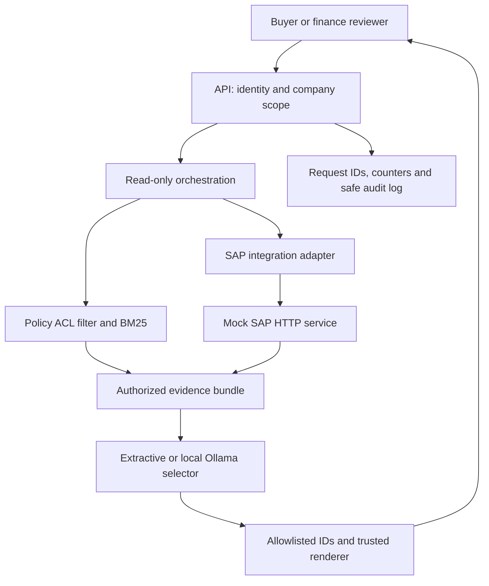

# Enterprise SAP AI Copilot

**A procurement exception assistant that combines live business facts with permission-filtered policy evidence.** Built as an AI Solutions Architect portfolio case study by Abdelrahman Osama, with AI-assisted implementation. All entities, company codes, policies, amounts and thresholds are synthetic. This is an independent demonstration, without customer data or employer endorsement.

A buyer sees a blocked purchase order and needs to understand the exception and the relevant operating policy. Today that can require moving between ERP screens and policy documents. This project demonstrates a small, auditable architecture for that workflow: read the authorized order, retrieve authorized policy, and produce cited evidence for a human reviewer.

The architecture emphasizes identity, enterprise integration boundaries, grounded output, evaluation and operational visibility. No component can approve orders or make payments.

## Run in under a minute

Requires **Python 3.11+**, no pip dependencies, account, network access or confidential SAP system.

```bash
python3 -m copilot demo
python3 -m unittest discover -s tests -v
python3 -m copilot eval
```

Run these commands from the extracted repository directory. `demo` starts two actual loopback HTTP services on temporary ports, executes examples, then shuts them down. It creates no credentials on disk. `eval` writes `evals/latest-results.json` and exits nonzero on any failed gate.

For a persistent API:

```bash
python3 -m copilot serve
```

In another terminal, from the repository directory:

```bash
TOKEN=$(python3 -c 'import json; print(json.load(open(".runtime/tokens.json"))["buyer-eg"])')
curl -s http://127.0.0.1:8080/v1/ask \
  -H "Authorization: Bearer $TOKEN" \
  -H 'Content-Type: application/json' \
  -d '{"company_code":"EG01","purchase_order":"4500001001","question":"Why is this purchase order blocked?"}'
unset TOKEN
```

The API listens on `127.0.0.1:8080`; the mock SAP service on `127.0.0.1:8081`. Generated opaque bearer tokens live in ignored `.runtime/tokens.json`; deleting that file before restart rotates them. CTRL+C stops both services. These demo identities are local credentials, not production SSO.

Expected evidence includes:

> Purchase order 4500001001 for Nile Demo Supplies is Blocked; net amount 125000.00 EGP; exception receipt_missing; last changed 2026-10-01T09:00:00Z. [sap:4500001001]
>
> For EG01, an invoice with a missing goods receipt stays blocked. The buyer must verify receipt evidence with the warehouse; finance reviews the invoice only after receipt is recorded in SAP. [alpha-eg-receipt]

The full response contains evidence objects, source versions, provider mode, latency, a synthetic-data notice and a request ID. The timestamp is the fixture's source timestamp; this does not imply synchronization with a real ERP.

## Architecture



[Detailed architecture and production target](docs/architecture.md) · [Security model](docs/security-model.md) · [ADRs](docs/adr/README.md) · [API contract](docs/api.md)

## What is implemented

| Concern | Runnable implementation | Deliberate boundary |
| --- | --- | --- |
| Enterprise API | Separate HTTP mock; fixed PO lookup; schema validation; source projection | OData-shaped contract, not an SAP-certified service or full OData server |
| Retrieval | Scope-local BM25 with a minimum lexical coverage gate and versioned policy chunks | Tiny English corpus; no embeddings, vector database or semantic ranking |
| Identity | Generated bearer tokens mapped to immutable server-owned subjects | Replace with validated OIDC/JWT and authoritative entitlements in production |
| Authorization | Tenant, company and role ACLs before scoring, top-k and model context; independent mock checks | No claim of full SAP authorization-object parity |
| RAG output | Retrieved context is supplied to optional Ollama; model selects evidence IDs; trusted code compiles exact claims | Constrained extractive RAG, not free-form narrative generation |
| Safety | No write route or write-capable tool; suspicious instruction heuristic; strict output validation | Regex detection is imperfect; structural controls carry the security boundary |
| Observability | Correlation IDs, structured safe audit log, per-route/status counters, response latency | No OpenTelemetry backend, durable audit retention or distributed tracing deployment |
| Evaluation | Synthetic positive, denial, abstention and refusal cases over real local HTTP | Contract gates do not measure broad reasoning, semantic quality or production readiness |
| Delivery | Automated tests, GitHub Actions workflow, dependency-free local startup, optional Docker demo | GitHub CI passes on Python 3.11, 3.12 and 3.13; Docker remains unverified |

## Optional real local model

Default `extractive` mode deterministically renders retrieved evidence. It is the offline reproducibility baseline and **does not invoke an LLM**.

With [Ollama](https://docs.ollama.com/) installed and running locally:

```bash
ollama pull qwen2.5:3b
COPILOT_PROVIDER=ollama OLLAMA_MODEL=qwen2.5:3b python3 -m copilot demo
COPILOT_PROVIDER=ollama OLLAMA_MODEL=qwen2.5:3b python3 -m copilot eval --output evals/ollama-results.json
```

Ollama receives only the authorized evidence bundle and the question, with a JSON-schema output contract. The application rejects unknown or duplicate IDs, extra output fields, empty selections, and omission of the requested live PO. It renders selected evidence text itself; model-authored facts never enter the response. There is no silent fallback if the model is unavailable or invalid. Models can still select irrelevant evidence or omit a useful policy: that is a quality failure to evaluate.

The live-model commands require a download and hardware suitable for the chosen model. The adapter's request/response contract is tested with mocked responses; **a downloaded Ollama model was not run for the committed baseline**. Run and review the model evaluation before presenting live-model performance.

## Security demonstration

| Persona | Tenant | Company scope | Business role |
| --- | --- | --- | --- |
| `buyer-eg` | alpha | EG01 | procurement |
| `buyer-sa` | alpha | SA01 | procurement |
| `finance-eg` | alpha | EG01 | finance |
| `buyer-beta` | beta | EG01 | procurement |
| `operator` | alpha | none | metrics only |

Try a cross-company request with `buyer-eg`: HTTP 403. Try beta's PO `4500003001` as `buyer-eg`: HTTP 404, identical to an unknown PO. Finance escalation evidence is excluded from procurement retrieval. Client-supplied role fields are rejected, and identity headers cannot override the authenticated subject.

The service forwards the authenticated user's token plus a separate ephemeral service credential to the mock SAP boundary. It never sends client-supplied identity headers or an arbitrary URL. Supplier bank data is excluded from both the upstream response and the adapter projection.

## Validation

The recorded baseline is [evals/baseline-results.json](evals/baseline-results.json). See [validation report](docs/validation.md) for actual checks and remaining verification gaps. Re-run locally rather than treating one latency sample as an SLA.

```bash
make check
# Optional isolated demo image:
docker build -t enterprise-sap-ai-copilot .
docker run --rm --read-only --tmpfs /tmp enterprise-sap-ai-copilot
```

The image runs the transient `demo` command, which binds loopback inside the container and exits. No port publishing is needed. The image is not a production API deployment.

## Repository map

| Path | Purpose |
| --- | --- |
| `copilot/security.py` | Identity, scope checks, safety heuristic, rate limiter |
| `copilot/integration.py` | Read-only SAP adapter and response projection |
| `copilot/retrieval.py` | Authorization-aware BM25 index |
| `copilot/providers.py` | Offline and Ollama selectors; output validation |
| `copilot/service.py` | Orchestration, decisions and evidence rendering |
| `copilot/http.py` | API and mock SAP HTTP boundaries; safe telemetry |
| `copilot/runtime.py` | Two-service startup and shutdown |
| `data/` | Independent synthetic PO and policy fixtures |
| `tests/` | Security, integration, failure and provider-contract tests |
| `evals/` | Versioned scenarios and baseline evidence |
| `docs/` | Architecture, decisions, threat model, operations and interview guide |
| `.github/workflows/ci.yml` | Tests and evaluation gates across Python versions |

## Interview story

1. Explain the business decision: make exception evidence faster to find while retaining SAP as the system of record.
2. Trace one request through identity, object-level authorization, the live API and permission-filtered retrieval.
3. Demonstrate a denial and an injection refusal, then show why security does not rely on the prompt.
4. Discuss the tradeoff between bounded grounded output and fluent generation, and the offline baseline versus actual LLM evaluation.
5. Show failure behavior, evaluation evidence and the production gaps you would close before a pilot.

[Ten-minute demo and likely interview questions](docs/interview-guide.md) · [Production integration plan](docs/production-integration.md) · [GitHub publication steps](docs/publication.md)

No business benefit, production scale or customer deployment is claimed by this synthetic case study. MIT licensed; see [LICENSE](LICENSE).
