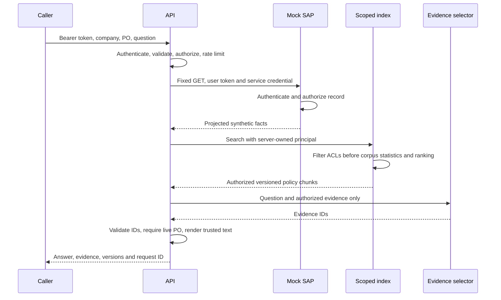
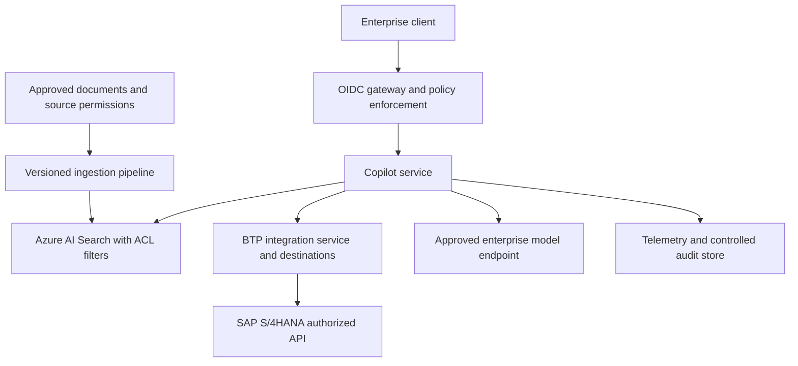

# Architecture and trust boundaries

## Local implementation

The CLI starts two HTTP servers in one process. This preserves a real serialization/authentication boundary without requiring distributed infrastructure. The adapter cannot shortcut the mock through an in-memory repository. `runtime.running` gives integration tests the same path as the CLI. Sharing a process is an operational simplification, not a tenant-isolation boundary against local filesystem administrators.

A policy chunk is a single manually curated rule, with `id`, `tenant`, `companies`, `roles`, `title`, `text`, and `version`. The demo corpus has no document ingestion API. In production, an ingestion pipeline must copy ACLs from the authoritative source, split documents without losing ACLs, reject stale/invalid permissions, track hashes and versions, and atomically activate a new index. User prompts are never written to the index.

Retrieval uses BM25 (`k1=1.2`, `b=0.75`). The corpus and IDF are calculated after ACL filtering so inaccessible documents do not affect rankings. At least half the distinct non-stopword query terms must occur in the chunk. This is a transparent heuristic, not a calibrated confidence probability. Known PO exception codes enrich the retrieval query; business rules are not inferred by a model.

The model sees no authentication token, supplier bank field, raw ERP object or unavailable policy. The trusted renderer uses evidence IDs from the current request bundle; no global lookup is allowed. Source versions are displayed. Exact rendering guarantees text provenance, not that a source policy is true, current, applicable, or free of malicious instructions.

## Production target: proposed, not provisioned

The production mapping keeps the same boundaries, but replaces implementations. OIDC claims must be validated before they become an application principal. Integration can be a CAP/Cloud SDK service on BTP. The application must construct search filters from server-authorized identity, never from the model or client query. Exact SAP API, communication arrangement and auth flow depend on edition, release and deployment.

## Failure and consistency behavior

| Condition | Behavior |
| --- | --- |
| Missing/invalid credential | 401; no business execution |
| Company outside principal scope | 403 before lookup |
| Missing or other-tenant PO in allowed company | Uniform 404 |
| Read timeout / unreachable upstream | 503; no fabricated business facts |
| Upstream HTTP failure / malformed object | 502, except uniform upstream 404 |
| Invalid/unavailable model | 502/503; no silent offline fallback |
| Unsupported question / no matching policy | Explicit abstention with empty evidence |
| Requested financial mutation | Read-only refusal; no write route exists |
| Suspicious user instruction | Refusal; heuristic is defense in depth |
| Concurrent request slots exhausted | 503 busy |

There is no cache, conversational memory or batch write operation. Live fixture facts are read on each PO request; policy versions are fixed at startup. Restart activates file changes. These choices remove cache authorization mistakes but do not solve cross-source snapshot consistency; a production answer should display observation time and source versions and apply freshness limits.
